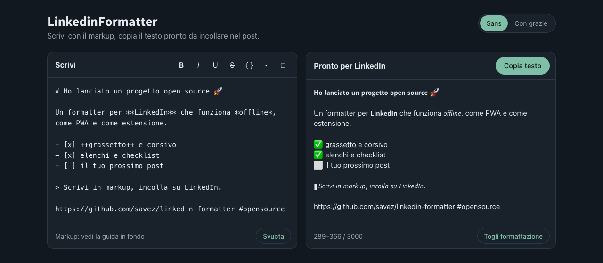

<div align="center">


# 𝗟𝗶𝗻𝗸𝗲𝗱𝗶𝗻𝗙𝗼𝗿𝗺𝗮𝘁𝘁𝗲𝗿

**Grassetto, corsivo, sottolineato ed elenchi nei post LinkedIn.**
Scrivi in markup, copia, incolla. Funziona offline, non invia niente a nessuno.

[](https://github.com/savez/linkedin-formatter/actions/workflows/ci.yml)
[](https://github.com/savez/linkedin-formatter/releases/latest)
[](LICENSE)
[](CONTRIBUTING.md)

[**Chrome / Edge**](https://github.com/savez/linkedin-formatter/releases/latest/download/linkedin-formatter-chrome.zip) ·
[**Firefox**](https://github.com/savez/linkedin-formatter/releases/latest/download/linkedin-formatter-firefox.zip) ·
[**Come si installano**](docs/INSTALLAZIONE.md) ·
[**Come funziona**](docs/come-funziona.md)



</div>

---

LinkedIn non ha il grassetto. Il trucco che vedi nei post è un altro: le lettere
vengono sostituite con caratteri Unicode che *sembrano* grassetto o corsivo
(𝗰𝗼𝘀𝗶̀, 𝘤𝘰𝘴𝘪̀). Questo progetto lo fa per te, in tre forme:

| | Cos'è | Per chi |
|---|---|---|
| 📱 **PWA** | App web installabile su telefono e desktop, funziona offline | Chi scrive dal telefono o non vuole installare estensioni |
| 🧩 **Estensione Chrome** | Popup nella barra + clic destro *Formatta per LinkedIn* | Chrome, Edge, Brave, Arc, Opera |
| 🦊 **Estensione Firefox** | Stessa cosa, per Firefox | Firefox 142+ |

Tutte e tre nascono **dallo stesso codice**: le estensioni sono generate dalla PWA
a ogni rilascio, quindi si comportano in modo identico.

## ✨ Cosa sa fare

- **Markup al posto dei pulsanti**: `**grassetto**`, `*corsivo*`, `++sottolineato++`,
  `~~barrato~~`, `` `monospazio` ``, titoli, elenchi, checklist, citazioni. È il
  formato che usi già, e quello che scrive qualsiasi LLM.
- **Anteprima dal vivo** con il conteggio caratteri sul limite di 3000 di LinkedIn.
- **22 stili su tutto il testo**: calligrafico, doppio tratto, larghezza piena,
  elenchi numerati, ordinamento A→Z e altri. Un clic e copi.
- **Link, #hashtag e @menzioni restano cliccabili**, anche dentro un grassetto.
- **Le lettere accentate funzionano**: à è é ì ò ù diventano grassetto come le altre.
- **Togli formattazione**: incolli un vecchio post e torna testo semplice da modificare.
- **Scorciatoie**: <kbd>Ctrl</kbd>/<kbd>⌘</kbd> + <kbd>B</kbd> <kbd>I</kbd> <kbd>U</kbd> sulla selezione.
- **Condividi verso l'app** (Android): da qualsiasi app, *Condividi → LinkedinFormatter*.
- **Privacy totale**: nessun server, nessun tracciamento, nessuna dipendenza esterna.
  La bozza resta nel tuo browser.

## 🚀 Installazione

### Estensione per Chrome, Edge, Brave

1. Scarica [`linkedin-formatter-chrome.zip`](https://github.com/savez/linkedin-formatter/releases/latest/download/linkedin-formatter-chrome.zip) ed estrailo.
2. Apri `chrome://extensions` e attiva **Modalità sviluppatore**.
3. **Carica estensione non pacchettizzata** → scegli la cartella estratta.

### Estensione per Firefox

1. Scarica [`linkedin-formatter-firefox.zip`](https://github.com/savez/linkedin-formatter/releases/latest/download/linkedin-formatter-firefox.zip).
2. Apri `about:debugging#/runtime/this-firefox`.
3. **Carica componente aggiuntivo temporaneo** → scegli lo zip.

Firefox rimuove le estensioni temporanee alla chiusura. Se la release contiene
anche `linkedin-formatter-firefox.xpi` (versione firmata), basta aprirlo con
Firefox e l'installazione resta.

👉 Passaggi dettagliati, aggiornamenti e soluzione dei problemi in
[**docs/INSTALLAZIONE.md**](docs/INSTALLAZIONE.md).

### PWA

Apri l'app nel browser e scegli *Installa* (Chrome/Edge) o *Aggiungi alla schermata
Home* (Safari, iOS). Serve HTTPS: per pubblicarla sul tuo dominio usa
`linkedin-formatter-pwa.zip` della release, è un sito statico.

## ✍️ Il markup

| Scrivi | Ottieni |
|---|---|
| `**testo**` o `__testo__` | 𝘁𝗲𝘀𝘁𝗼 |
| `*testo*` o `_testo_` | 𝘵𝘦𝘴𝘵𝘰 |
| `***testo***` | 𝙩𝙚𝙨𝙩𝙤 |
| `++testo++` | t̲e̲s̲t̲o̲ |
| `~~testo~~` | t̶e̶s̶t̶o̶ |
| `` `testo` `` | 𝚝𝚎𝚜𝚝𝚘 |
| `# Titolo` | riga intera in grassetto |
| `- punto` | • punto |
| `- [ ] da fare` / `- [x] fatto` | ⬜ da fare / ✅ fatto |
| `> citazione` | ▍*citazione* in corsivo |
| `---` | ━━━━━━━━━━ |

Gli stili si annidano: `**grassetto con *corsivo***`.

> [!TIP]
> Usa la formattazione per il gancio iniziale e due o tre parole chiave, non per
> paragrafi interi: i caratteri Unicode non sono indicizzati dalla ricerca di
> LinkedIn e i lettori di schermo li leggono male.

## 🛠️ Sviluppo

Nessun framework, nessun bundler, nessuna dipendenza: JavaScript vanilla e Node.js ≥ 20 solo per test e build.

```bash
git clone https://github.com/savez/linkedin-formatter.git
cd linkedin-formatter
npm start        # serve src/ su http://localhost:5173
npm test         # test del formatter (node:test)
npm run build    # dist/pwa, dist/chrome, dist/firefox + zip
```

```
src/                  la PWA: è l'unica sorgente dell'interfaccia
  formatter.js        logica di formattazione (browser e Node)
  app.js              interfaccia
  index.html  sw.js  manifest.webmanifest  icons/
extension/            solo ciò che serve in più alle estensioni
  background.js       menu contestuale "Formatta per LinkedIn"
  extension.js/.css   popup e pulsante "Apri in una scheda"
scripts/build.mjs     genera PWA ed estensioni Chrome/Firefox (Manifest V3)
test/                 test del formatter
```

Per aggiornare un'estensione caricata da sorgente: `npm run build`, poi
*Ricarica* in `chrome://extensions` puntando a `dist/chrome`.

## 📦 Rilasci

I rilasci sono automatici con [release-please](https://github.com/googleapis/release-please):

1. I commit su `main` seguono i [Conventional Commits](https://www.conventionalcommits.org/it/) (`feat:`, `fix:`…).
2. release-please tiene aperta una PR con la prossima versione e il [CHANGELOG](CHANGELOG.md).
3. Quando la PR viene unita: tag, release su GitHub e, allegati, gli zip di PWA, Chrome e Firefox.

La versione di `package.json` finisce nel `manifest.json` delle estensioni e nella
cache del service worker, così ogni rilascio aggiorna anche chi ha la PWA installata.

## 🤝 Contribuire

Segnalazioni, idee e pull request sono benvenute: parti da [CONTRIBUTING.md](CONTRIBUTING.md).
Cerchi qualcosa da cui iniziare? Guarda le issue
[`good first issue`](https://github.com/savez/linkedin-formatter/labels/good%20first%20issue).

## 🔗 Progetti collegati

- **Skill per agenti AI**: un porting Python 1:1 di `formatter.js`, che fa scrivere i
  post a un agente già formattati, vive in [savez/my-skills](https://github.com/savez/my-skills).

## 📄 Licenza

[MIT](LICENSE) © Saverio Menin

<sub>Progetto indipendente, non affiliato né approvato da LinkedIn Corporation. LinkedIn è un marchio registrato di LinkedIn Corporation.</sub>
